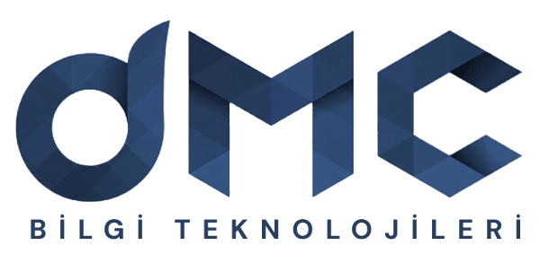

  <picture>
    <source media="(prefers-color-scheme: dark)" srcset="assets/dmc-logo-beyaz.png">
    
  </picture>

  <a href="https://www.dmcteknoloji.com/">dmcteknoloji.com</a> ·
  <a href="https://sentineldb360.com/">sentineldb360.com</a> ·
  <a href="https://www.dmcteknoloji.com/blog/">Blog</a> ·
  <a href="https://www.linkedin.com/company/dmcteknoloji">LinkedIn</a> ·
  <a href="https://www.dmcteknoloji.com/iletisim/">İletişim</a>

## DMC Bilgi Teknolojileri

İstanbul'da, veritabanı üzerine çalışan bir yönetilen hizmet ve danışmanlık şirketiyiz. SQL Server, PostgreSQL, MySQL/MariaDB ve MongoDB ortamlarını işletiyor, performans sorunlarını çözüyor, Always On ve cluster mimarisi kuruyor, bulut geçişi yapıyoruz. Kurucumuz Çağlar Özenç altı kez Microsoft Data Platform MVP unvanı aldı. Merkezimiz Eyüpsultan'da, Ar-Ge ofisimiz Düzce Teknopark'ta.

Burada gördüğünüz depolar bu işin açık kısmı: teşhis script'leri, demo uygulamalar ve kitapların kodu.

### Açık kaynak

| Depo | Ne işe yarar |
|---|---|
| [dmc-dba-toolkit](https://github.com/dmcteknoloji/dmc-dba-toolkit) | SQL Server, PostgreSQL, MySQL ve MongoDB için 81 teşhis script'i. Varsayılan olarak salt okunur, CI'da gerçek motorlara karşı çalıştırılıyor. |
| [mssql-health-mcp](https://github.com/dmcteknoloji/mssql-health-mcp) | SQL Server sağlık bilgisini yapay zeka istemcilerine salt okunur açan MCP sunucusu. |
| [dmc-sql-saglik](https://github.com/dmcteknoloji/dmc-sql-saglik) | Bu MCP sunucusunu herhangi bir yapay zeka istemcisine bağlayan Windows kurulum paketi. |
| [dmcshop-sql2025](https://github.com/dmcteknoloji/dmcshop-sql2025) | SQL Server 2025 graph ve vektör (DiskANN) özelliklerini Blazor ile gösteren demo mağaza. Canlısı [demo.dmcteknoloji.com](https://demo.dmcteknoloji.com) adresinde. |
| [doris-superset-lab](https://github.com/dmcteknoloji/doris-superset-lab) | Apache Doris, PostgreSQL ve SQL Server'ı aynı 20 milyon satırla karşılaştıran Docker laboratuvarı. |

### Kitaplar

- [SQL Server 2025 başucu kitabı](https://github.com/dmcteknoloji/sql-server-2025-kitap): Türkçe. Kod örnekleri, errata ve okur tartışmaları bu depoda.
- [SQL Server 2025 geliştirici kitabı](https://github.com/dmcteknoloji/sql-server-2025-gelistirici-kitabi): Türkçe ve İngilizce, yazılımcılar için.
- [Yapay Zeka Ne Zaman Yanılır?](https://github.com/dmcteknoloji/yapay-zeka-ne-zaman-yanilir): kitaptaki 29 ölçümün ham verisi ve betikleri. Cetveller ölçümden önce yazıldı.

### Ürünler

**SentinelDB360** veritabanlarının sağlık ve güvenlik durumunu ölçen yazılım ailemiz. Ücretsiz [Lite](https://github.com/dmcteknoloji/sentineldb360-lite) sürümünü bu hesaptan indirebilirsiniz. Platform ve Security sürümleri için [sentineldb360.com](https://sentineldb360.com/).

### Katkı ve iletişim

Bir script'te hata bulursanız ilgili depoya issue açın. SQL Server 2025 başucu kitabıyla ilgili soru ve öneriler için deponun [Tartışmalar](https://github.com/dmcteknoloji/sql-server-2025-kitap/discussions) sekmesi açık. İş görüşmesi için [iletişim formu](https://www.dmcteknoloji.com/iletisim/) ya da 0212 945 61 66.

---

<b>English</b>

 

DMC Bilgi Teknolojileri is an Istanbul-based managed services and consulting company focused on databases. We run SQL Server, PostgreSQL, MySQL/MariaDB and MongoDB estates, fix performance problems, design Always On and cluster setups, and handle cloud migrations. Our founder Çağlar Özenç has been a Microsoft Data Platform MVP six times.

The repositories here are the open part of that work:

- **[dmc-dba-toolkit](https://github.com/dmcteknoloji/dmc-dba-toolkit):** 81 diagnostic scripts for four engines, read-only by default and tested in CI against real servers.
- **[mssql-health-mcp](https://github.com/dmcteknoloji/mssql-health-mcp)** and **[dmc-sql-saglik](https://github.com/dmcteknoloji/dmc-sql-saglik):** a read-only SQL Server health MCP server and its Windows installer.
- **[dmcshop-sql2025](https://github.com/dmcteknoloji/dmcshop-sql2025):** a SQL Server 2025 graph and vector demo store.
- **[doris-superset-lab](https://github.com/dmcteknoloji/doris-superset-lab):** Doris, PostgreSQL and SQL Server on the same 20 million rows.
- **[SQL Server 2025 developer book](https://github.com/dmcteknoloji/sql-server-2025-gelistirici-kitabi):** bilingual, Turkish and English.

Our product family is **[SentinelDB360](https://sentineldb360.com/en/)**. Found a bug? Open an issue in the repository. Anything else: [dmcteknoloji.com](https://www.dmcteknoloji.com/).

