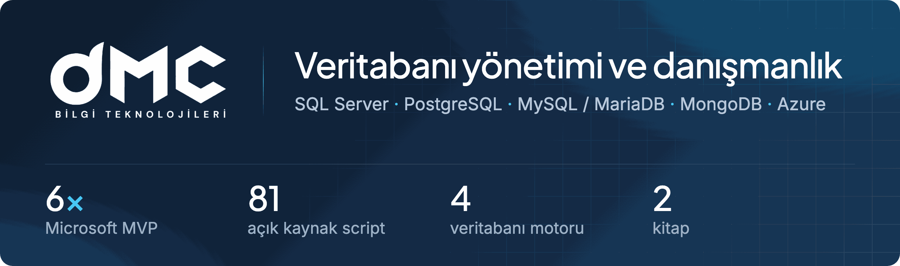

  
  
  
  

İstanbul'da kurulu, işi veritabanı olan bir şirketiz. Müşterilerimizin SQL Server, PostgreSQL, MySQL/MariaDB ve MongoDB sunucularını gece gündüz izliyor, yavaşlayan sorguyu buluyor, Always On kuruyor, veriyi buluta taşıyoruz. Kurucumuz [Çağlar Özenç](https://caglarozenc.com/) ([LinkedIn](https://www.linkedin.com/in/caglarozenc)) altı kez Microsoft Data Platform MVP seçildi. Merkez ofisimiz Eyüpsultan'da, Ar-Ge ofisimiz Düzce Teknopark'ta.

Aşağıdaki depolar bu işin açık kaynak kısmı.

## Açık kaynak

<table>
<tr>
<td width="50%" valign="top">

**[dmc-dba-toolkit](https://github.com/dmcteknoloji/dmc-dba-toolkit)** 
Dört motor için 81 teşhis script'i. Varsayılan olarak salt okunur. Her değişiklikte CI, script'lerin hepsini gerçek bir SQL Server, PostgreSQL, MySQL ve MongoDB'ye karşı çalıştırıyor.

</td>
<td width="50%" valign="top">

**[mssql-health-mcp](https://github.com/dmcteknoloji/mssql-health-mcp)** 
SQL Server'ın sağlık bilgisini yapay zeka istemcilerine salt okunur açan MCP sunucusu. Windows kurulumu için [dmc-sql-saglik](https://github.com/dmcteknoloji/dmc-sql-saglik).

</td>
</tr>
<tr>
<td width="50%" valign="top">

**[dmcshop-sql2025](https://github.com/dmcteknoloji/dmcshop-sql2025)** 
SQL Server 2025'in graph ve vektör (DiskANN) özelliklerini bir demo mağaza üzerinde gösteren Blazor uygulaması. [Canlı demo](https://demo.dmcteknoloji.com).

</td>
<td width="50%" valign="top">

**[doris-superset-lab](https://github.com/dmcteknoloji/doris-superset-lab)** 
Apache Doris, PostgreSQL ve SQL Server'a aynı 20 milyon satır yükleniyor, altı rapor sorgusu ölçülüyor, üstünde Superset var. Amaç kendi donanımınızda kendi sayınızı almanız.

</td>
</tr>
</table>

## Kitaplar

| Kitap | İçerik |
|---|---|
| **[SQL Server 2025 başucu kitabı](https://github.com/dmcteknoloji/sql-server-2025-kitap)** | Türkçe. Kod örnekleri, errata ve okur [tartışmaları](https://github.com/dmcteknoloji/sql-server-2025-kitap/discussions). |
| **[SQL Server 2025 geliştirici kitabı](https://github.com/dmcteknoloji/sql-server-2025-gelistirici-kitabi)** | Yazılımcılar için, Türkçe ve İngilizce. |
| **[Yapay Zeka Ne Zaman Yanılır?](https://github.com/dmcteknoloji/yapay-zeka-ne-zaman-yanilir)** yayına hazırlanıyor | Kitaptaki 29 ölçümün ham verisi ve betikleri. Her ölçümün cetveli, ölçüm yapılmadan önce yazıldı. |

## Blogdan son yazılar

<!-- BLOG-BASLA -->
- [MySQL 8.0 desteği Nisan 2026'da bitti, 8.4 LTS'e geçişte nelere dikkat edilmeli](https://www.dmcteknoloji.com/yonetilen-veritabani-hizmetleri/mysql-8-0-destek-sonu-8-4-gecis/) 22.10.2026
- [PostgreSQL 14 desteği 12 Kasım 2026'da bitiyor, hangi sürüme ve nasıl geçilir](https://www.dmcteknoloji.com/yonetilen-veritabani-hizmetleri/postgresql-14-destek-sonu/) 22.10.2026
- [Redgate araçları SQL Server ekibine ne katar, ne zaman gerekmez](https://www.dmcteknoloji.com/yonetilen-veritabani-hizmetleri/sql-server/redgate-araclari-sql-server-ekibine-ne-katar/) 22.10.2026
- [Yapay zeka dönüşümü: kurum nereden başlar](https://www.dmcteknoloji.com/veri-platformlari/yapay-zeka-donusumu-nereden-baslanir/) 19.09.2026
- [Yapay zeka dönüşümünde kim ne yapar](https://www.dmcteknoloji.com/veri-platformlari/yapay-zeka-donusumunde-kim-ne-yapar/) 17.09.2026
<!-- BLOG-BITIR -->

[Tüm yazılar →](https://www.dmcteknoloji.com/blog/)

## Ne yapıyoruz

- **[Yönetilen veritabanı hizmetleri](https://www.dmcteknoloji.com/hizmetlerimiz/yonetilen-veritabani-hizmetleri/):** 7/24 izleme, yedek ve kurtarma, yama, kapasite planlama.
- **[Yüksek erişilebilirlik ve performans](https://www.dmcteknoloji.com/hizmetlerimiz/yuksek-erisilebilirlik-ve-performans/):** Always On, cluster, replikasyon, sorgu ve indeks optimizasyonu.
- **[Bulut ve hibrit](https://www.dmcteknoloji.com/hizmetlerimiz/bulut-ve-hibrit-cozumler/):** Azure, AWS, Google Cloud ve Huawei Cloud geçişleri.
- **[SentinelDB360](https://sentineldb360.com/):** veritabanı sağlık ve güvenlik değerlendirme yazılımımız. Ücretsiz Lite sürümü [burada](https://github.com/dmcteknoloji/sentineldb360-lite/releases/latest).

Script'lerde hata görürseniz ilgili depoya issue açın. İş için [iletişim formu](https://www.dmcteknoloji.com/iletisim/) ya da 0212 945 61 66.

<b>English</b>

 

DMC Bilgi Teknolojileri is a database company based in Istanbul. We monitor SQL Server, PostgreSQL, MySQL/MariaDB and MongoDB estates around the clock, track down slow queries, build Always On clusters and move data to the cloud. Our founder [Çağlar Özenç](https://caglarozenc.com/) is a six-time Microsoft Data Platform MVP.

The repositories below are the open source part of that work. [dmc-dba-toolkit](https://github.com/dmcteknoloji/dmc-dba-toolkit) has 81 read-only diagnostic scripts for four engines, and CI runs every one of them against real servers. [mssql-health-mcp](https://github.com/dmcteknoloji/mssql-health-mcp) gives AI clients read-only access to SQL Server health data. [dmcshop-sql2025](https://github.com/dmcteknoloji/dmcshop-sql2025) is a demo store built on SQL Server 2025 graph and vector search, and [doris-superset-lab](https://github.com/dmcteknoloji/doris-superset-lab) loads the same 20 million rows into Doris, PostgreSQL and SQL Server so you can measure them on your own hardware. The [SQL Server 2025 developer book](https://github.com/dmcteknoloji/sql-server-2025-gelistirici-kitabi) is bilingual.

Our product family is [SentinelDB360](https://sentineldb360.com/en/). Anything else: [dmcteknoloji.com](https://www.dmcteknoloji.com/).

